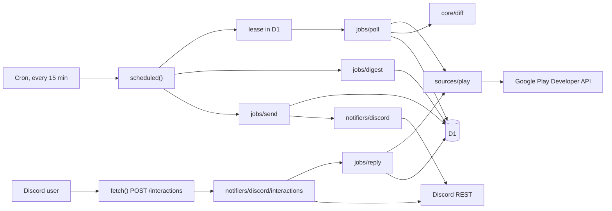
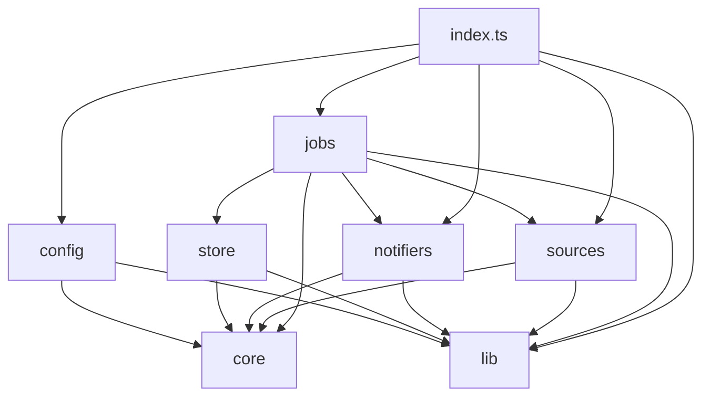

# Atticus architecture

The living description of how Atticus is built. It outlives any one version. Feature plans (`docs/v1/V1.md`, and later `docs/<feature>/<FEATURE>.md`) are written as deltas against it, and the chunk that lands a structural change updates this file in the same commit.

Where this file and the code disagree about a fact, the code wins: fix this file.

---

## The shape

One Cloudflare Worker with two entry points and one D1 database.



- **The cron** polls each app, diffs against D1, writes review changes and outbox rows together, checks whether a digest is due, then drains the outbox to Discord within a fixed budget.
- **The interactions endpoint** verifies Discord's signature, checks the allow-list and channel, shows the reply modal, and publishes the reply on Google Play in `waitUntil`.
- **D1** holds the review history (beyond Play's 7-day window), the Discord message mapping, the outbox and a little key/value state.

---

## Modules and the dependency rule

```
src/
  index.ts      wires scheduled() and fetch(); nothing else
  env.ts        the Worker's bindings type
  config/       parse + validate the env into a typed Config
  core/         the Review type and pure logic: diff, digest stats, time and text helpers
  sources/      ReviewSource interface; one folder per store (play/)
  notifiers/    Notifier interface; one folder per chat platform (discord/)
  jobs/         orchestration: poll, send, deliver, digest, reply, health
  store/        D1 queries; the only place SQL lives
  lib/          tiny shared utilities: log, budget, base64url, PEM
migrations/     numbered D1 migrations
test/           unit and integration tests, fixtures/
```

**Who may import whom** (enforced in review, and by keeping imports one-directional):



- **`core/` imports nothing but `lib/`'s pure helpers.** No `fetch`, no D1, no env, no store or platform knowledge. Everything here is a pure function with unit tests.
- **`sources/` knows one store and nothing about chat.** Raw API JSON never leaves `sources/<store>/`; it's normalised into `Review` there.
- **`notifiers/` knows one chat platform and nothing about stores.** It renders from `Review` and digest data. Discord's interaction handling lives in `notifiers/discord/` and calls `jobs/reply`, which is platform-agnostic. That call is the one edge from `notifiers/` back to `jobs/`. `jobs/reply` does not import `notifiers/`; the interaction webhook edit and follow-up stay in `notifiers/discord/`.
- **`store/` is the only place with SQL.** Jobs call named functions (`insertReviewWithOutbox`, `claimPending`, …), never `env.DB` directly.
- **`jobs/` combines the others.** The interactions handler is the exception: it calls `jobs/reply`, then edits the Discord message itself.
- **`index.ts`** builds the config, the budget and the concrete source and notifier, and hands them to jobs.

---

## Extension points

These are the seams future versions plug into. Keep them clean even when a shortcut is tempting.

| To add | Do | Don't |
| --- | --- | --- |
| A store (App Store, v2) | `sources/appstore/` implementing `ReviewSource`; a `store` value in `APPS`; a migration if a column is missing. | Touch `core/diff` or the notifiers with store-specific cases. |
| A chat platform (Telegram, v1.1) | `notifiers/telegram/` implementing `Notifier`; its own inbound handler calling `jobs/reply`. | Teach `jobs/send` about Telegram's API. |
| A per-app setting (channel, …) | A field on `APPS` entries, parsed in `config/`. | A new flat env var per app. |
| A slash command (v1.1) | A handler in `notifiers/discord/interactions.ts` calling a job; `scripts/register-commands.ts`. | Query D1 from the interaction handler directly. |
| A new outbox kind | A `kind` value, a `Notifier` method, a renderer. | Send to Discord outside the outbox from the cron. |
| A schema change | A new `migrations/000N_*.sql`. | Edit an existing migration after it has shipped. |

---

## Free-tier budget

The Workers free plan is the hardest constraint. Re-verify at https://developers.cloudflare.com/workers/platform/limits/.

| Resource | Limit | How Atticus stays inside it |
| --- | --- | --- |
| External subrequests per invocation | 50 | One `Budget` per invocation, capped at 45. Every Google and Discord call takes from it. The outbox carries the rest to the next run. |
| CPU per invocation | 10 ms | No runtime dependencies, native WebCrypto, the Google token cached in memory, pages of at most 100 reviews, rendering kept simple. Measured with `wrangler tail`. |
| Cron triggers per account | 5 | One. The digest is a time check inside it. |
| Cron wall time | 15 min | The sender stops after 60 s; the lease lasts 10 min. |
| `waitUntil` after responding | 30 s | The reply flow makes three calls at most (token, reply, message edit). |
| D1 | generous | Batched writes; old outbox rows are pruned after 30 days. |

---

## Rules that hold everywhere

- **Security** (`SPEC.md` §11): every interaction is signature-verified before parsing; only allow-listed users in the configured channel can reply; secrets only via `wrangler secret`; never log or echo a secret; the service account gets "Reply to reviews" and view access for the needed apps only.
- **Privacy:** review data lives only in the user's own D1 database and the Discord channel. Logs carry ids and statuses, never review text, names or reply text.
- **No unintended pings:** every Discord message sets `allowed_mentions`; only the configured low-rating role or user can ever be mentioned.
- **Humans write replies.** Nothing posts a reply without a person submitting it.
- **Zero runtime dependencies.** Adding one needs the owner's yes and a line in `DECISIONS.md`.
- **Idempotent by construction:** a crash at any step must not double-post or lose a review. Write to D1 first, send from the outbox, use nonces.

---

## Standing smokes

Any change that touches the matching area runs these before it lands. The full v1 list is in `docs/v1/V1.md` → Smokes.

- **Signature:** bad or missing → `401`; `PING` → `PONG`.
- **Allow-list:** a user not on the list can't open the modal.
- **No double posts:** two runs back to back, and an injected crash between send and mark, each give one message per review version.
- **No pings:** `@everyone` in a review's text pings nobody.
- **Budget:** a run never makes more than 45 external calls (integration test).
- **Clean logs:** no review text, names, reply text or tokens in `wrangler tail`.
- **`npm run check`** green.

---

## Testing

- **Unit (Vitest):** `core/`, `config/`, `sources/play/normalize`, the Discord renderers and signature verification. Fixtures in `test/fixtures/` are realistic API responses, including the edge cases (no author, no device metadata, translated, with a developer reply, multi-page).
- **Integration (`@cloudflare/vitest-plugin`, which replaced `@cloudflare/vitest-pool-workers`):** the Worker inside the Workers runtime against a real local D1 with migrations applied. Cloudflare removed `fetchMock`, so tests stub `globalThis.fetch` to stand in for Google and Discord and restore it afterwards. Cron runs and interactions end to end, asserting D1 state and the exact outbound calls.
- **Test secrets are placeholders.** Wrangler reads `.dev.vars` for the test runtime too, so `vitest.config.ts` overrides every secret binding with a placeholder, and a test asserts it. A new secret gets a placeholder there in the same change.
- **Manual, on the dev Worker:** real Lune reviews into the test channel, `DRY_RUN=true`; real replies only with the owner's go-ahead.

---

## Environments

| Environment | Worker | D1 | Discord application | Channel | `DRY_RUN` |
| --- | --- | --- | --- | --- | --- |
| Local | `wrangler dev` | local | — (signature tests use generated keys) | — | `true` |
| Dev | `atticus-dev` | `atticus-dev` | Atticus Dev | the test channel | `true` |
| Production | `atticus` | `atticus` | Atticus | Lune's reviews channel | `false` |

Local secrets go in `.dev.vars` (gitignored). Deployed secrets only via `wrangler secret put` (`--env dev` for dev).
